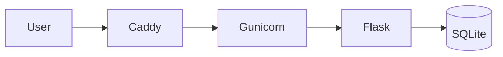

# Inventaris Bengkel Motor

Cloud Computing — PTI 2802  
Pertemuan 3 — Project Inception

## Author
Rizki Hermawan / 25832073002 / PTI 2A

## Problem
Pemilik dan petugas bengkel motor kesulitan mencatat dan mencari data suku cadang pada pencatatan manual.

## Target Users
Pemilik dan petugas bengkel motor. Setiap bengkel memiliki akun sendiri.

## Features M03
- baseline application: daftar akun bengkel, login, dan CRUD barang per bengkel
- health endpoint
- VPS deployment

## Architecture

## Infrastructure
- Ubuntu Server 24.04
- 2 vCPU
- 1.9Gi RAM
- 19G disk
- Caddy
- Gunicorn

## Public Endpoint
`http://103.193.177.228/`

## Health Check
`GET /health`

## Deployment
See `docs/deployment.md`.

## Security
- key-only SSH
- root SSH disabled
- UFW enabled
- backend loopback-only
- tidak ada secret di repository
- password pengguna disimpan dalam bentuk hash

## Current Limitations
- HTTP only
- database SQLite berbasis file
- no container
- manual deployment

## Roadmap
M04 DNS/HTTPS, M05 Data, M06 Container, M07 IaC, M09 CI/CD
