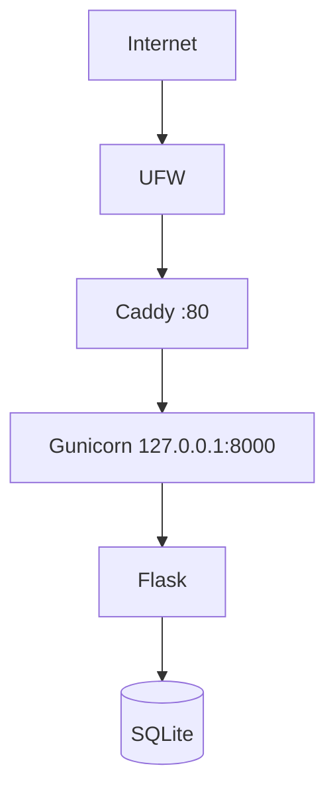

# Architecture v0.1

## Deployment View

## Resource Constraints
- 2 vCPU
- 1.9Gi RAM
- 19G disk

## Data Model
- `bengkel`: id, nama, email (unik), password
- `barang`: id, bengkel_id (mengacu ke bengkel, ON DELETE CASCADE), nama, kategori, stok, harga

## Security Decisions
- non-root administration
- SSH key authentication
- password SSH disabled
- UFW enabled
- backend loopback-only
- akses halaman data dibatasi login (`login_required`)
- file `secret.key` dan database tidak masuk Git (.gitignore)
- password pengguna disimpan dalam bentuk hash

## Current Limitations
- HTTP only
- single VPS
- database SQLite berbasis file (belum ada data service terpisah)
- no container
- no CI/CD

## Planned Evolution
- M04 DNS + HTTPS
- M05 persistent data
- M06 container
- M07 IaC
- M09 CI/CD
